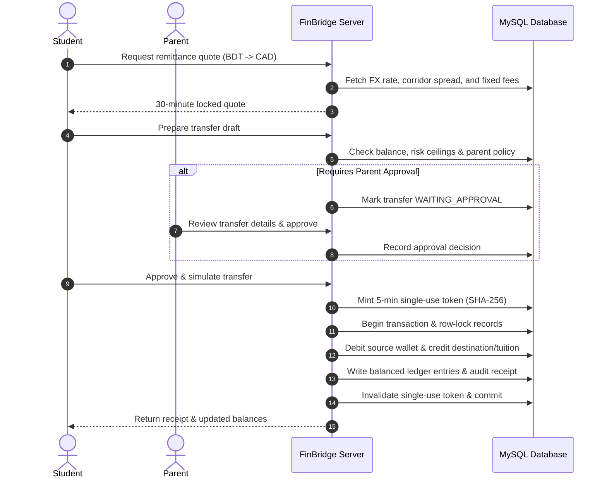
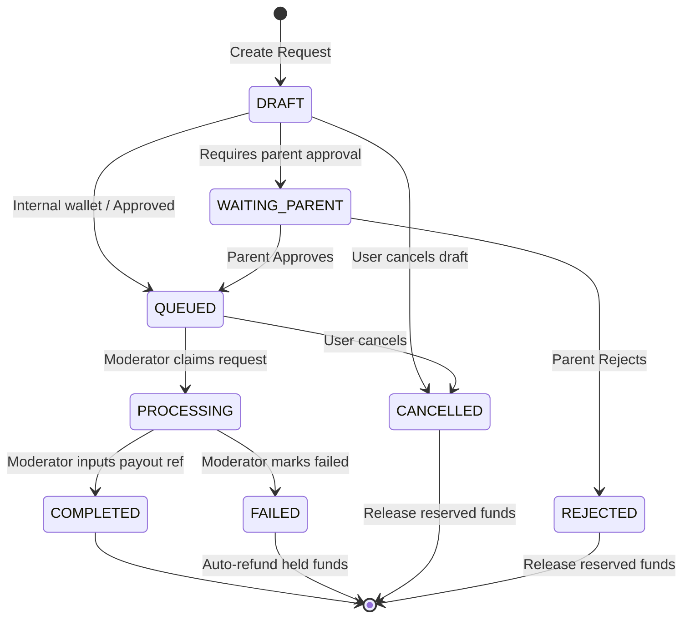
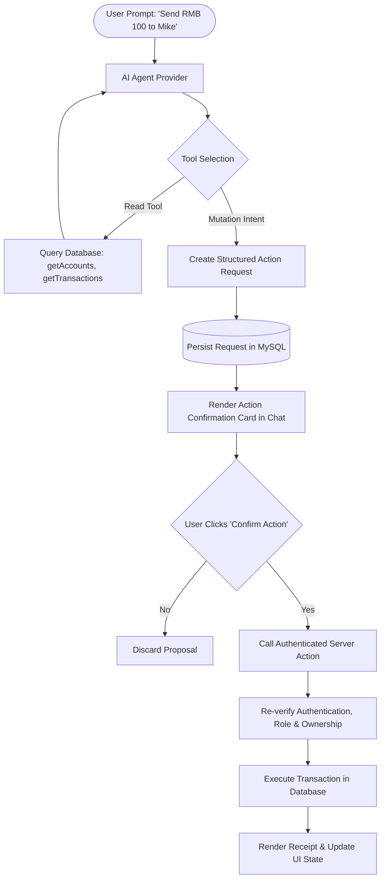

# FinBridge AI — Cross-Border & Student Finance Assistant

[](https://nextjs.org/)
[](https://react.dev/)
[](https://www.typescriptlang.org/)
[](https://tailwindcss.com/)
[](https://www.mysql.com/)
[](#testing-and-verification)

FinBridge AI is an intelligent financial management and cross-border remittance assistant designed for international students, families, and educational sponsors. It bridges the gap between home-country funding and foreign-study expenses through multi-currency wallets, tuition forecasting, simulated remittance comparisons, parental financial governance, and an autonomous AI financial copilot.

> [!NOTE]
> All balances, exchange rates, remittance providers, and payment transfers in this application are **sandbox simulation data**. No real money is transferred.

---

## Table of Contents

- [Core Capabilities](#core-capabilities)
- [Architecture & Technology Stack](#architecture--technology-stack)
- [Project Structure](#project-structure)
- [Getting Started & Installation](#getting-started--installation)
- [Database Setup & Management](#database-setup--management)
- [Environment Variables](#environment-variables)
- [Demo Accounts & Credentials](#demo-accounts--credentials)
- [Application Sitemap & Routes](#application-sitemap--routes)
- [Financial & Remittance Sandbox Engine](#financial--remittance-sandbox-engine)
- [Unified Payment & Settlement Workflow](#unified-payment--settlement-workflow)
- [AI Copilot & Structured Tool Engine](#ai-copilot--structured-tool-engine)
- [Family Circle & Parental Governance](#family-circle--parental-governance)
- [Subscription Plans & Quota Boundaries](#subscription-plans--quota-boundaries)
- [Security, Privacy & Internationalization](#security-privacy--internationalization)
- [Testing and Verification](#testing-and-verification)
- [Competition Demonstration Guide](#competition-demonstration-guide)

---

## Core Capabilities

### 🎓 1. Student Finance & Tuition Planning
- **Multi-Currency Accounts**: Manage checking, savings, cash, and digital wallets across 111 global currencies (primary focus on CNY, BDT, CAD, USD, EUR, GBP).
- **Transaction Management**: Categorized expenses and income with real-time balance calculations, confidence scoring, search, filter, and pagination.
- **Bulk CSV Imports**: Upload bank statements (up to 5 MB, 2,000 rows) with flexible column mapping, pre-import preview, and atomic rollback on validation failure.
- **Tuition Invoice Forecast**: Track invoices, deadlines, scholarship credits, and monthly savings targets. Calculates projected living obligations to highlight real funding gaps.
- **Category Budgets**: Set monthly limits with visual spending progress and automated overspending warnings.

### 🌐 2. Cross-Border Remittance Simulation
- **Corridor Price Comparison**: Evaluate simulated providers (StudentTransfer, GlobeSend, SwiftBank, FastRemit) factoring in base fees, percentage charges, and exchange rate spreads.
- **Server-Locked Quotes**: 30-minute guaranteed quote expiry preventing client-side price tampering.
- **Cryptographic Sandbox Execution**: 5-minute single-use SHA-256 tokens for transfer simulation, ensuring strict authorization and idempotency.
- **Double-Entry Ledger**: Balanced debit/credit entries with immutable receipts and cryptographic audit records.

### 💳 3. Unified Payment & Manual Settlement Queue
- **Supported Channels**: FinBridge internal wallet transfers, demo card deposits, and manual external channels (Bank/Wire Transfer, PayPal, Alipay, WeChat Pay, UnionPay).
- **State Machine Lifecycle**: `DRAFT` ➔ `WAITING_PARENT` ➔ `QUEUED` ➔ `PROCESSING` ➔ `COMPLETED` / `FAILED` / `CANCELLED`.
- **Parent-Governed Beneficiaries**: Student outgoing transfers to new beneficiaries require parental approval. Configurable auto-approval thresholds for one-time transfers.
- **Moderator Settlement Queue**: Role-restricted settlement dashboard (`/admin/settlements`) to review, process, and complete pending requests with payout references.

### 🤖 4. Autonomous AI Financial Copilot
- **Multi-Provider Support**: Deterministic local mock provider (zero API key needed), Google Gemini (`gemini-3.8-flash`), and OpenAI adapters.
- **Secure Key Encryption**: API keys encrypted with authenticated AES-256-GCM in MySQL; never returned to client browsers.
- **Application-Owned Tools**: Inspect balances, retrieve transactions, compare transfer corridors, check tuition deadlines, and suggest budgets.
- **Structured Action Requests**: AI cannot execute mutations directly; it proposes structured, validated action proposals (`draftPayment`, `requestAction`, `open_page`, `require_answer`) requiring explicit user confirmation.

### 👨‍👩‍👧 5. Family Circle & Parental Governance
- **Student-Parent Linking**: Secure invitation workflow with cryptographic invite tokens.
- **Granular Visibility Matrix**: Configurable viewing permissions for balances, category totals, transaction descriptions, tuition invoices, and budgets.
- **Strict Spending Controls**: Transfer threshold triggers, per-transfer caps, daily/monthly ceilings, tuition/conversion switches, and per-category monthly limits. Parents can tighten, but never relax, platform risk limits.

### 🛡️ 6. Administration & Role-Based Moderation
- **Role Hierarchy**: `STUDENT`, `PARENT`, `ADMIN`, `MODERATOR`.
- **Granular Moderator Delegations**: Specific sections assigned per moderator (`reports`, `team`, `agent`, `models`, `users`, `finance`, `catalog`).
- **Risk Ceilings Engine**: Configurable daily/monthly ceilings, transfer frequency limits, and large-transfer review thresholds.
- **Public Team & Leadership Profiles**: Editable team directory with illustrated SVG avatars and designations.

---

## Architecture & Technology Stack

| Layer | Technology | Purpose |
| --- | --- | --- |
| **Framework** | Next.js 16.4 (App Router) | Server-side rendering, routing, Server Actions |
| **Frontend** | React 19, Tailwind CSS 4, Material UI | Responsive UI components, typography, dark/light theme |
| **Charts** | MUI X Charts, React Flow (`@xyflow/react`) | Visual financial metrics, workflow flowcharts |
| **Language** | TypeScript 6.0 | Strict type safety across client and server |
| **Database** | MySQL 8.0 / MariaDB 10.4+ (`mysql2/promise`) | Relational persistence, connection pooling, transactions |
| **Math Precision** | Decimal.js | Exact financial decimal math, zero floating-point error |
| **Validation** | Zod 4 | Schema validation for forms, CSV rows, and AI tools |
| **Authentication** | `jose` (JWT), `bcryptjs` | Signed stateless httpOnly cookies, salted bcrypt hashes |
| **AI Integration** | `@google/genai`, `openai` | Gemini 3.8 Flash, OpenAI Responses with function calling |
| **Testing** | Playwright, Node Test Runner, `tsx` | End-to-end browser workflows, integration, unit tests |

### Architectural Principles

1. **Server Actions Only (`"use server"`)**: No REST API routes or external backend servers. Every mutation and query runs inside authenticated Next.js Server Actions with role and ownership verification.
2. **Double-Entry Ledger Integrity**: Every balance mutation produces paired debit and credit entries with explicit balance checks.
3. **Idempotency & Concurrency Locks**: Database transactions and row-level locks prevent race conditions, double credits, and duplicate execution.
4. **Zero Client Secret Exposure**: Database credentials, encryption secrets, and AI provider API keys remain strictly on the server.

---

## Project Structure

```text
├── database/
│   ├── schema.sql                   # Complete unified DDL schema (57 tables)
│   └── seed.sql                     # Unified base reference & demo sample data
├── public/                          # Brand assets, logos, and static icons
├── scripts/
│   ├── setup.mjs                    # One-command database initializer (schema + seed)
│   ├── migrate.mjs                  # Incremental migrations & historical rate generator
│   ├── generate-demo.mjs            # Regenerator for database/seed.sql
│   ├── platform-migration.mjs       # Additive platform column & catalog migration
│   ├── payment-migration.mjs        # Additive payments & settlement migration
│   ├── demo-team.mjs                # Demo moderator team setup & avatar generator
│   └── provision-local.mjs          # Optional local XAMPP/MySQL database bootstrap
├── src/
│   ├── actions/                     # Authenticated Server Actions ("use server")
│   │   ├── account.actions.ts       # Account creation, edit, archiving
│   │   ├── admin.actions.ts         # Risk policy, user control, plans, catalog
│   │   ├── agent.actions.ts         # AI chat conversation and execution
│   │   ├── agent-workflow.actions.ts# Action proposals and user confirmations
│   │   ├── alert.actions.ts         # Alert dismissal and snooze controls
│   │   ├── auth.actions.ts          # Login, registration, password reset, demo switch
│   │   ├── budget.actions.ts        # Category monthly budgets
│   │   ├── credit.actions.ts        # Credit task tracking
│   │   ├── dashboard.actions.ts     # Aggregated workspace financial summary
│   │   ├── parent.actions.ts        # Family link approvals, invitations, controls
│   │   ├── payment.actions.ts       # Unified payment requests, card deposits, payouts
│   │   ├── platform.actions.ts      # Team profiles, model management, photo updates
│   │   ├── preferences.actions.ts   # Locale, theme, and preferred currency updates
│   │   ├── report.actions.ts        # User feedback and compliance reports
│   │   ├── subscription.actions.ts  # Demo checkout and subscription upgrades
│   │   ├── transaction.actions.ts   # Transaction entry and CSV batch imports
│   │   ├── transfer.actions.ts      # Remittance quote and transfer simulation
│   │   ├── tuition.actions.ts       # Invoices and tuition funding scenarios
│   │   └── user.actions.ts          # Profile and account closure
│   ├── ai/                          # AI Providers and Tool Definitions
│   │   ├── tools/index.ts           # Strictly typed financial tool definitions
│   │   ├── action-catalog.ts        # Catalog of safe client-confirmed actions
│   │   ├── gemini-provider.ts       # Google Gemini 3.8 Flash adapter
│   │   ├── openai-provider.ts       # OpenAI Responses API adapter
│   │   ├── mock-provider.ts         # Offline deterministic simulation provider
│   │   └── model-config.ts          # Encrypted key storage and retrieval
│   ├── app/                         # Next.js 16 App Router
│   │   └── [locale]/                # Locale-aware layouts and pages
│   │       ├── [[...path]]/         # Dynamic view dispatcher
│   │       ├── globals.css          # Theme CSS and Tailwind styling
│   │       └── layout.tsx           # Root HTML layout and providers
│   ├── components/                  # React Presentation Components
│   │   ├── accounts/                # Wallet and account management cards
│   │   ├── admin/                   # Administrative panels and settlement queue
│   │   ├── agent/                   # AI chat interface and action confirmation cards
│   │   ├── billing/                 # Plan tier selectors and checkout modal
│   │   ├── budget/                  # Category spending progress charts
│   │   ├── charts/                  # MUI X Chart visualizers
│   │   ├── dashboard/               # Financial overview widgets and stat tiles
│   │   ├── family/                  # Parental controls and linked student views
│   │   ├── forms/                   # Validated input dialogs and forms
│   │   ├── layout/                  # Sidebar navigation, navbar, theme toggles
│   │   ├── payments/                # Payment tabs, deposit forms, settlement list
│   │   ├── settings/                # Security, model configuration, card tokens
│   │   ├── transfers/               # Remittance corridors and quote preview
│   │   ├── tuition/                 # Invoice progress and funding gap analyzer
│   │   └── ui/                      # Modals, buttons, notifications, badges
│   ├── dictionaries/                # Translations: en.json, zh-CN.json, bn-BD.json
│   ├── lib/                         # Core Utilities & Business Rules
│   │   ├── admin-permissions.ts     # Moderator section permissions
│   │   ├── audit.ts                 # Audit logging helper
│   │   ├── auth.ts                  # Session resolution and current user query
│   │   ├── avatar.ts                # Profile photo validation and sanitization
│   │   ├── db.ts                    # MySQL connection pool and query helpers
│   │   ├── money.ts                 # Decimal.js calculations and formatting
│   │   ├── payment-rules.ts         # Payment limits and fee calculators
│   │   ├── permissions.ts           # Route guard and role authorization
│   │   ├── plan-limits.ts           # Subscription quota boundary enforcer
│   │   ├── risk-engine.ts           # Ceiling, frequency, and duplicate transfer checks
│   │   ├── secrets.ts               # AES-256-GCM encryption for credentials
│   │   └── session.ts               # JWT creation, verification, cookie management
│   ├── services/                    # Domain Business Logic
│   │   ├── automatic-alerts.service.ts # Workspace alert evaluation
│   │   ├── currency.service.ts      # FX rate catalog and conversions
│   │   ├── financial-config.service.ts # Admin risk and corridor settings
│   │   ├── parent-controls.service.ts # Strict parent cap enforcement
│   │   ├── payment.service.ts       # Unified payment processing engine
│   │   ├── remittance.service.ts    # Corridor quotes and fee breakdown
│   │   ├── sandbox-payment.service.ts # Demo card charges and token storage
│   │   └── tuition.service.ts       # Tuition funding gap calculations
│   └── types/                       # TypeScript interfaces and shared types
└── tests/                           # Test Suites
    ├── agent-actions.test.ts        # AI tool validation and action catalog tests
    ├── finance.test.ts              # Decimal math, tuition forecast, and fee tests
    ├── payments.integration.ts      # Shared financial state machine integration tests
    ├── platform.test.ts             # Moderator permissions and photo upload tests
    ├── providers.test.ts            # Gemini/OpenAI adapter contract tests
    └── e2e/                         # Playwright browser end-to-end specifications
```

---

## Getting Started & Installation

### Prerequisites
- **Node.js**: `v22.0.0` or newer.
- **npm**: `v10.0.0` or newer.
- **Database**: MySQL 8.0+ or MariaDB 10.4.32+ (e.g., standard XAMPP MySQL).

### 1. Clone & Install Dependencies
```powershell
git clone https://github.com/your-username/Cross-border-and-Student-Finance-Assistant.git
cd Cross-border-and-Student-Finance-Assistant
npm install
```

### 2. Configure Environment Variables
Copy `.env.example` or create `.env.local` in the project root:
```powershell
Copy-Item .env.example .env.local
```

### 3. Initialize Database
Create your MySQL database and grant permissions:
```sql
CREATE DATABASE finbridge_ai CHARACTER SET utf8mb4 COLLATE utf8mb4_unicode_ci;
CREATE USER 'finbridge'@'localhost' IDENTIFIED BY 'your-password-here';
GRANT ALL PRIVILEGES ON finbridge_ai.* TO 'finbridge'@'localhost';
FLUSH PRIVILEGES;
```

Execute the automated database setup (imports schema and seeds demo data):
```powershell
npm run db:setup
```

### 4. Start Development Server
```powershell
npm run dev
```

Open [http://127.0.0.1:3000/en/demo](http://127.0.0.1:3000/en/demo) in your browser.

---

## Database Setup & Management

FinBridge AI maintains a consolidated database architecture:

- **[database/schema.sql](file:///c:/Users/WALTON/Downloads/Git-Jibon/Cross-border-and-Student-Finance-Assistant/database/schema.sql)**: The complete, self-contained DDL definition containing all 57 application tables, primary keys, foreign key constraints, indexes, ENUM types, and microsecond `TIMESTAMP(6)` precisions.
- **[database/seed.sql](file:///c:/Users/WALTON/Downloads/Git-Jibon/Cross-border-and-Student-Finance-Assistant/database/seed.sql)**: The unified seed dataset containing 111 currencies, 166 countries, transaction categories, plan tiers, remittance providers, payment methods, admin risk settings, and the complete demo dataset (students, parents, admins, moderator team members with avatars, accounts, transactions, and budgets).

### Available Database Commands

```powershell
# Initialize schema and seed data
npm run db:setup

# Run additive migrations and generate illustrative FX history
npm run db:migrate

# Regenerate seed.sql with fresh demo timestamps and avatars
node scripts/generate-demo.mjs
```

---

## Environment Variables

| Variable | Required | Default | Description |
| --- | :---: | --- | --- |
| `DB_HOST` | Yes | `127.0.0.1` | MySQL server host address |
| `DB_PORT` | Yes | `3306` | MySQL server port |
| `DB_NAME` | Yes | `finbridge_ai` | Dedicated database name |
| `DB_USER` | Yes | `finbridge` | Database username |
| `DB_PASSWORD` | Yes | — | Database user password |
| `SESSION_SECRET` | Yes | — | 32+ character secret for JWT session signing |
| `AI_KEY_ENCRYPTION_SECRET` | No | `SESSION_SECRET` | 32+ character key for AES-256-GCM encryption of saved AI keys |
| `APP_URL` | No | `http://localhost:3000` | Application base URL |
| `NEXT_PUBLIC_APP_NAME` | No | `FinBridge AI` | Display name and brand title |
| `AI_MODE` | No | `mock` | Default AI provider: `mock`, `gemini`, or `openai` |
| `OPENAI_API_KEY` | No | — | Optional system-level OpenAI API key |
| `OPENAI_MODEL` | No | `gpt-4o-mini` | Optional system-level OpenAI model name |
| `DEMO_MODE` | No | `true` | Enables role-switcher buttons and demo credentials on `/demo` |

---

## Demo Accounts & Credentials

When `DEMO_MODE=true`, all seeded accounts can be accessed using password: **`DemoOnly!2026`**.

| Role | Email | Starting Plan | Purpose & Initial State |
| --- | --- | :---: | --- |
| **Student** | `student@finbridge.demo` | **Pro** | Tsinghua University student with CNY 16,880 + BDT 780,000 + USD 420. Tuition invoice: CNY 41,680. |
| **Parent** | `parent@finbridge.demo` | **Family** | Linked parent with Family RMB wallet (CNY 25,000) and configured transfer controls. |
| **Administrator**| `admin@finbridge.demo` | **Pro** | Full administrative rights over users, risk policy, settlement queue, and shared AI models. |
| **Moderator (CEO)** | `amina@example.com` | — | Chief Executive Officer profile; access to reports triage and team directory. |
| **Moderator (Eng)** | `li@example.com` | — | Head of Engineering profile; access to AI agent audit and AI models. |
| **Moderator (Support)**| `sadia@example.com` | — | Student Support Lead profile; access to user accounts and support reports. |
| **Moderator (Finance)**| `chen@example.com` | — | Finance Operations Lead; access to finance risk settings and currency catalog. |

> [!TIP]
> You can switch between any demo persona with one click from the **/en/demo** page.

---

## Application Sitemap & Routes

All application routes are localized with `/[locale]` (`/en`, `/zh-CN`, `/bn-BD`):

```text
Public Pages
├── /en                      # Landing page with interactive feature preview
├── /en/features             # Comprehensive feature breakdown
├── /en/how-it-works         # Step-by-step student and parent journey
├── /en/pricing              # Subscription tiers and feature comparison
├── /en/security             # Security practices, encryption, and data boundaries
├── /en/about                # Mission statement and verified leadership team
├── /en/terms                # Service terms
├── /en/privacy              # Privacy policy
└── /en/demo                 # Interactive role-switcher demo hub

Authentication
├── /en/login                # Authenticated session login
├── /en/register             # Student or Parent registration (with profile photo upload)
├── /en/forgot-password      # Password reset flow
└── /en/onboarding           # Initial profile setup (country, university, currency)

Student Workspace
├── /en/dashboard            # Central overview: balances, tuition alert, quick actions
├── /en/money                # Multi-currency account balances and wallet breakdown
├── /en/transactions         # Searchable transaction history and CSV batch import
├── /en/wallet               # Currency wallet details and internal balance exchange
├── /en/transfer             # Remittance corridor comparison and transfer simulation
├── /en/tuition              # Tuition invoice scheduler and funding gap calculator
├── /en/budget               # Category budget targets and monthly spend visualizer
├── /en/credit               # Country-specific credit builder checklist
├── /en/payments             # Unified deposit, external send, and withdrawal hub
├── /en/beneficiaries        # Saved and parent-approved transfer beneficiaries
├── /en/agent                # AI Copilot chat with interactive action confirmations
├── /en/alerts               # Deduplicated financial alerts and notification center
├── /en/activity             # Comprehensive immutable audit log and transfer receipts
└── /en/family               # Family Circle link status and active parental restrictions

Parent Workspace
├── /en/parent               # Parent home: linked students, balances, and quick actions
├── /en/parent/students      # Detailed financial view of linked student accounts
├── /en/parent/approvals     # Queue of pending transfer and beneficiary approvals
└── /en/parent/controls      # Thresholds, category caps, and auto-approval limits

Account & Settings
├── /en/subscription         # Active subscription status and quota consumption
├── /en/subscription/checkout# Simulated checkout for plan upgrades
├── /en/settings             # Profile editing, saved cards, and personal AI model keys
├── /en/reports              # Support ticket submission and issue reporting
├── /en/security-assessment  # Application security architecture overview
└── /en/project-evidence     # Verification logs, test results, and compliance proof

Administration & Moderation
├── /en/admin                # Admin KPI overview and platform health
├── /en/admin/settlements    # Manual payout and external settlement queue
├── /en/admin/payment-methods# Configured deposit and withdrawal payment options
├── /en/admin/users          # User list, role adjustments, and account suspension
├── /en/admin/plans          # Subscription tiers, pricing, and feature limits
├── /en/admin/subscriptions  # Active platform subscriptions and billing history
├── /en/admin/reports        # Triage and resolution of user-submitted reports
├── /en/admin/risk           # Platform-wide transfer ceilings and large-transaction thresholds
├── /en/admin/agent          # Global agent run logs and tool execution metrics
├── /en/admin/finance        # Currency corridor routes and remittance provider rates
├── /en/admin/audit          # System-wide immutable security audit log
├── /en/admin/settings       # Global system parameters and default currencies
├── /en/admin/catalog        # Active currencies and country mappings
├── /en/admin/models         # Shared system AI models with encrypted keys
└── /en/admin/team           # Team directory and moderator permission assignments
```

---

## Financial & Remittance Sandbox Engine

The remittance sandbox guarantees realistic pricing, predictable fees, and tamper-proof execution:



---

## Unified Payment & Settlement Workflow

FinBridge AI features a full-lifecycle payment engine:



---

## AI Copilot & Structured Tool Engine

The upgraded agent supports Gemini, OpenAI, Claude and compatible providers, persistent full-context conversations, role-checked action reviews, and provider usage monitoring. See [AI Agent configuration, migration and verification](docs/AI_AGENT.md) for the current behavior and testing boundaries.

The AI Copilot does not operate as an unconstrained chatbot; it uses an application-owned, schema-validated tool pipeline:



### Supported AI Actions
- **Account Actions**: Open pages, query balances, list transactions.
- **Tuition & Remittances**: Generate funding scenarios, compare remittance corridors.
- **Budgeting**: Recommend budget adjustments based on previous spending.
- **Payment Drafts**: Prepare transfers to saved beneficiaries for user confirmation.

---

## Family Circle & Parental Governance

Parents have supervisory capabilities designed to promote student financial independence while protecting the family budget:

- **Independent Wallets**: Parents hold separate wallets (e.g. Family RMB Wallet) and can send money directly to student wallets.
- **Spending Guardrails**:
  - `threshold`: Transfers above this amount trigger required parent authorization.
  - `per_transfer`, `daily_limit`, `monthly_limit`: Hard spending ceilings.
  - `tuition_approval`: Toggle requiring parent sign-off on tuition payments.
  - `category_limits`: Specific monthly budget caps for categories (e.g., Shopping, Food).
- **Strictest Policy Enforced**: In multi-parent setups, the strictest applicable limit always takes precedence. Parent limits can tighten platform ceilings, but can never exceed the global administrator risk limits.

---

## Subscription Plans & Quota Boundaries

The platform enforces monthly quota boundaries across four seeded plans:

| Feature Limit | Free Trial (7 Days) | Student | Pro (Seeded Student) | Family (Seeded Parent) |
| --- | :---: | :---: | :---: | :---: |
| **Monthly Price** | Free | 299 BDT / mo | 699 BDT / mo | 999 BDT / mo |
| **Annual Price** | Free | 2,990 BDT / yr | 6,990 BDT / yr | 9,990 BDT / yr |
| **Accounts / Wallets** | 1 | 5 | 20 | 20 |
| **AI Copilot Messages** | 30 / mo | 500 / mo | 2,000 / mo | 2,000 / mo |
| **Transfer Simulations** | 3 / mo | 30 / mo | 100 / mo | 100 / mo |
| **Tuition Forecast Plans** | 1 | 5 | 20 | 20 |
| **CSV Statement Imports**| 1 / mo | 10 / mo | 50 / mo | 50 / mo |
| **Family Circle Links** | 1 | 2 | 5 | 10 |

---

## Security, Privacy & Internationalization

- **Encrypted Model Keys**: AI API keys are encrypted at rest using AES-256-GCM authenticated encryption.
- **Strict Content-Type & MIME Validation**: Avatar profile uploads reject SVG, inspect image magic bytes via `sharp`, and enforce a 500 KB limit.
- **CSRF & Action Origin Protection**: Protected by Next.js Server Action origin verification and SameSite cookie policies.
- **Session Revocation**: User session versions increment on password reset or profile updates, instantly invalidating active sessions.
- **Localization (i18n)**:
  - English (`en`)
  - Simplified Chinese (`zh-CN`)
  - Bengali (`bn-BD`)
- **Theme Persistence**: Dark, Light, and System themes are persisted in MySQL user preferences, cookies, and `localStorage`.

---

## Testing and Verification

The test suite covers unit logic, database integration, and browser workflows:

```powershell
# 1. Run Unit Tests (Math, Tuition, Spreads, Risk, Auth)
npm test

# 2. Run Financial & Payment Integration Tests
npm run test:payments

# 3. Check TypeScript Type Integrity
npm run typecheck

# 4. Run Code Linter
npm run lint

# 5. Run Playwright End-to-End Browser Tests
npx playwright test
```

### Test Coverage Highlights
- **19 Unit Tests**: Verify Decimal.js precision, tuition gap formulas, fee calculation, risk hard stops, role boundaries, and AI provider sanitization.
- **10 Integration Tests**: Shared financial state machine, concurrent confirmations, external deposits, withdrawal reserves, parent governance, and automatic alert deduplication.

---

## Competition Demonstration Guide

Follow this 2-minute walkthrough to demonstrate the complete FinBridge AI platform:

1. **Access Demo Hub**: Navigate to [`/en/demo`](http://127.0.0.1:3000/en/demo) and click **Student**.
2. **Review Tuition Gap**: Open **Tuition Planner** (`/en/tuition`). Show the CNY 41,680 invoice, scholarship deduction, and the projected living cost funding gap.
3. **Engage AI Copilot**: Open **AI Agent** (`/en/agent`). Ask: *"Can I afford next semester?"* or *"Send RMB 100 to parent@finbridge.demo"*. Inspect the generated tool logs and confirmation proposal.
4. **Compare Remittance Corridors**: Open **Transfers** (`/en/transfer`). Compare real-time provider rates and fees between BDT and CAD.
5. **Parent Governance Workflow**:
   - Create an outgoing transfer exceeding the parent threshold (e.g., RMB 800).
   - In an incognito window, open `/en/demo` and select **Parent**.
   - Navigate to **Parent Approvals** (`/en/parent/approvals`) and approve the student's request with a note.
6. **Execute Transfer & View Ledger**:
   - Return to the Student window and click **Approve & simulate transfer**.
   - Show the generated receipt with cryptographic reference.
   - Navigate to **Activity** (`/en/activity`) to inspect balanced per-currency double-entry ledger records.
7. **Settlement Queue (Admin / Moderator)**:
   - Switch to **Administrator** or **Moderator (Chen Lin)**.
   - Open **Settlements** (`/en/admin/settlements`) to view queued requests, transition them to `PROCESSING`, and finalize payouts.

---

## License

This project is licensed under the ISC License. Developed for competition and demonstration purposes.
